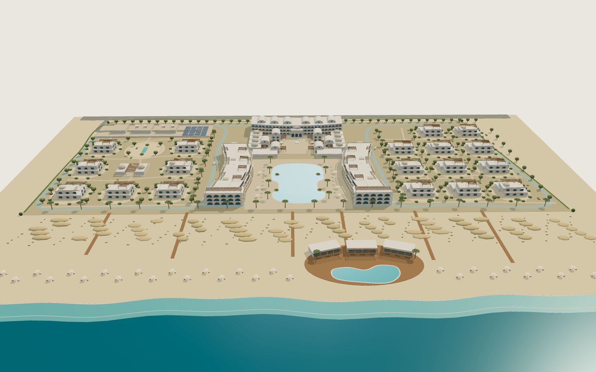

<div dir="rtl">

# AF4AI 3D Pipeline — محاكاة بناء تفاعلية 4D على الويب

حوّل أي مشروع معماري لصفحة ويب 3D، المبنى فيها **بيتبني قدام الزائر مرحلة ورا مرحلة**: الموقع ← الهيكل ← الأدوار ← الفتحات ← التشطيب ← الاكتمال. الزائر يقدر يلف حوالين المبنى 360° ويعمل زوم ويتنقّل بين المراحل، من الموبايل أو الكمبيوتر، من غير ما ينزّل أي برنامج.



**مثال حي:** [af4ai.com/3d/coastal-resort](https://af4ai.com/3d/coastal-resort/) · ونفس الصفحة من المستودع ده: [GitHub Pages](https://engfouly1987.github.io/af4ai-3d-pipeline/examples/coastal-resort-sharaa/web/)

## المدخلات
- **موديل GLB:** متصدّر من SketchUp، أو 3ds Max، أو Blender، أو Codex.
- **أو صورة واجهة / ريندر مع وصف نصي:** في الحالة دي الموديل بيتبني بالأكواد من الصورة (procedural modeling).
- **أو وصف بس:** يتملى منه pipeline عام من 41 خطوة.

## المخرجات
- صفحة Hero تفاعلية: شريط المراحل، والسكرول بيشغّل البناء، ولف 360°، وزوم، وزرار "إنهاء المعاينة".
- الموديل GLB، ونسخة Hero مضغوطة ومتقسّمة على المراحل، وملف Ruby تفتحه في SketchUp.
- صفحة فاضية لتصوير فريمات الفيديو، وريل 9:16 مدته 23 ثانية.
- لقطات مرجعية جاهزة لريندر الذكاء الاصطناعي، وكتيّب صور حسب المراحل.

## الفكرة التقنية باختصار
كل جزء في الموديل بيتعلّم بمرحلة من خلال اسم الخامة أو `extras.usage`:

| الرمز | المرحلة |
|---|---|
| `S` | الموقع |
| `T` | الهيكل |
| `O` | الفتحات والزجاج |
| `F` | الواجهة والزخارف |
| `R` | السطح والقباب |
| `L` | اللاندسكيب |

صفحة three.js / WebGL بتظهّر المراحل بالترتيب حسب قيمة التقدّم `p` من 0 لـ 1. الرسم بيحصل بس لما حاجة تتغيّر، والعناصر المتكررة بتتحوّل لـ InstancedMesh، فالصفحة خفيفة على الموبايل.

</div>

---

## Structure

```
skill/SKILL.md                 Claude skill: the full step-by-step studio workflow (Step 0 intake → Step 8 delivery)
kit/                           Pipeline kit v2
  lib/af4ai-model.mjs          build a model from parameters (grp, box, cyl, sph, inst, comp, wall, window_, rail, plants) → GLB + phase-tagged hero GLB + SketchUp .rb
  lib/prep-glb.mjs             prepare ANY outside GLB → full GLB + hero GLB (phases S/T/O/F/R/L, prune, weld, meshopt)
  lib/glb2rb.mjs               GLB → SketchUp Ruby (one component per mesh)
  hero/hero-buttons.html       the interactive hero (stage bar, scroll build, orbit, zoom, exit)
  hero/hero-video.html         empty mode for video frames (window.__p, __cam, __abs, __renderOnce)
  hero/standalone.mjs          one offline HTML with the model embedded
  shots/                       reference / AI-base shots (view.html + shots.mjs)
  video/                       frame renderer (cloud or local Edge+GPU), SIFT alignment, reel template
  pipeline/                    generic 41-step project pipeline + filler (facts.json → <slug>.pipeline.json)
examples/coastal-resort-sharaa Sharaa coastal resort, built from images + brief (Path B)
  source/generate.mjs          procedural model of the whole resort
  source/sharaa_add.mjs        landscape additions built with kit/lib/af4ai-model.mjs
  web/                         the published hero (index.html + sharaa.glb + poster.webp)
  reference/  qa/  report/     input briefs, QA renders, model report
docs/pipeline-guide.html       visual guide of the pipeline (Arabic)
```

## Quick start

```bash
git clone https://github.com/engfouly1987/af4ai-3d-pipeline.git
cd af4ai-3d-pipeline
npm install

# Path B: model from images/brief (the Sharaa example)
node examples/coastal-resort-sharaa/source/generate.mjs          # → examples/.../source/output/sharaa-coastal-resort.glb

# Path A: any GLB (SketchUp / 3ds Max / Blender / Codex) → phased hero GLB
node kit/lib/prep-glb.mjs in.glb out/ myproject [--usage NAME=site|landscape|facade|roof…] [--recolor mat=#hex]

# GLB → SketchUp Ruby (paste in Extensions › Developer › Ruby Console)
node kit/lib/glb2rb.mjs in.glb myproject_sketchup.rb
```

Then copy `kit/hero/hero-buttons.html`, set `CFG.desktop` / `CFG.mobile` to your GLB and the camera keys `K`, and open it through any static web server (or build one offline file with `kit/hero/standalone.mjs`).

### Using it with Claude
Install `skill/SKILL.md` as a skill (zip the `skill` folder as `af4ai-3d-pipeline/`). Then say for example *"start a new 3D project from this image"* or *"continue project …"*. The skill walks through every stage and asks before moving on. Replace the placeholders `<KIT>`, `<PROJECTS>` and `<LIBRARY>` with your own folders.

### From 3ds Max
Convert V-Ray/Corona materials to Physical / glTF materials, collapse modifiers and Reset XForm, convert proxies and scatters (Forest Pack, RailClone) to meshes, use metres. Then export GLB (built-in glTF exporter, Babylon.js exporter, or FBX → Blender → GLB) and follow Path A. Naming materials or layers with phase words (concrete, glass, facade, roof, tree…) gives the best phase split.

## Requirements
Node.js 18+ · for frames/shots: Chromium or Microsoft Edge (Playwright) · for video composition: Python 3 with Pillow, OpenCV, NumPy and ffmpeg.

---

**Author:** AF4AI · [af4ai.com](https://af4ai.com)
